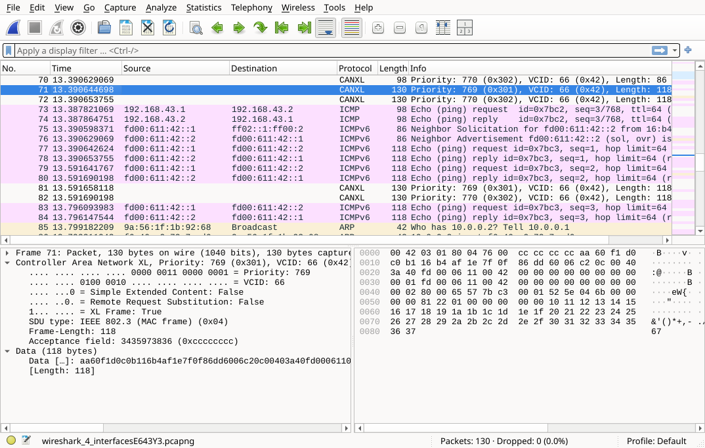

# can-cia-611-1-eth-poc
PoC for CAN CiA 611-1 Ethernet over CAN XL (SDT 0x04 / 0x05)

* Linux netdevice `canxl_eth`: an Ethernet interface stacked on top of a CAN XL interface
* IEEE 802.3 MAC frames are tunneled in CAN XL frames with the SDT 0x04 (IEEE 802.3 MAC frame) or SDT 0x05 (IEEE 802.3 MAC frame extended)
* Ethernet and other CAN XL traffic (other SDTs) share the same CAN XL interface in parallel
* hardware independent: `canxl_eth` is a regular user of the Linux PF_CAN network layer
* the Ethernet traffic is visible for PF_CAN tools like `candump` (e.g. for log files)
* configuration with iproute2 (`ip link ... type canxl_eth`)
* for discussion about the SDTs 0x04 and 0x05

```
  candump / cansend / ...                          IPv4 / IPv6 / ARP / VLAN ...
       |                                                               |
       |                                                       +---------------+
       |                                  canxl_eth netdevice  |     xleth0    |
       |                                                       +---------------+
       |                                                               |
+------|---------------------------------------------------------------|-------+
| +---------+ +---------+ +-----------+ +-----------+ +--------+ +-----------+ |
| | CAN_RAW | | CAN_BCM | | CAN_ISOTP | | CAN_J1939 | | CAN_GW | | canxl_eth | |
| +---------+ +---------+ +-----------+ +-----------+ +--------+ +-----------+ |
|                                                                              |
|                        PF_CAN network layer (af_can)                         |
+--------------------------------------+---------------------------------------+
                                       |
                               +---------------+
                               |      can0     |  CAN XL netdevice
                               +---------------+  (any CAN XL driver)
```

### Files

* linux-7.4-canxl_eth.patch : Linux kernel patch which adds the `canxl_eth` netdevice
* iproute2-7.4-canxl_eth.patch : iproute2 patch to configure `canxl_eth` netdevices
* out-of-tree : `canxl_eth` module for existing kernels (Linux 6.12 and later)
* canxl_eth_vxcan_test.sh : test `canxl_eth` without CAN XL hardware (vxcan and network namespaces)
* [INSTALL.md](INSTALL.md) : integrate, build and install the patches for Linux and iproute2
* [OUT-OF-TREE.md](OUT-OF-TREE.md) : build and install the `canxl_eth` module for an existing (e.g. Debian) kernel
* [SETUP.md](SETUP.md) : set up a CAN XL Ethernet with the `ip` tool (SDT 0x04/0x05, IPv4/IPv6, point-to-point)
* [CONCEPT.md](CONCEPT.md) : concept of the `canxl_eth` netdevice in the Linux network layer

### Status

* Linux patch for Linux 7.4 (applies to Linux 7.4-rc4)
* iproute2 patch based on the iproute2 main branch for the upcoming iproute2 7.4
* out-of-tree build of the `canxl_eth` module for Linux 6.12 and later (e.g. Debian 13) with DKMS support

### Example: Wireshark capture

The capture below has been created with `canxl_eth_vxcan_test.sh -r`, where side
A of the test setup remains in the root namespace in which Wireshark runs. The
capture contains the interfaces of side A: `vxcan_xltest0` (CAN XL) and the
`canxl_eth` devices `eth_xltest0`, `eth_xltest1` and `eth_xltest2` (Ethernet).



Wireshark dissects the CAN XL frames on `vxcan_xltest0`. The selected frame 71 is
the CAN XL frame of the Ethernet frame 77 on `eth_xltest1` (SDT 0x04 with VCID):

| | Frame 71 (`vxcan_xltest0`) | Frame 77 (`eth_xltest1`) |
|---|---|---|
| Time | 13.390644698 | 13.390642624 |
| Shown as | CANXL, Priority 0x301, VCID 0x42, length 130 | ICMPv6, length 118 |
| Content | Echo request, id 0x7bc3, seq 1, fd00:611:42::1 -> fd00:611:42::2 | the same |

The CAN XL frame fields match the `canxl_eth` settings of `eth_xltest1`:

| Field | Value | Setting |
|---|---|---|
| Priority | 769 (0x301) | `tx_prio 0x301` |
| VCID | 66 (0x42) | `tx_vcid 0x42` |
| SEC / RRS | False / False | `sec off`, `rrs off` |
| SDT | IEEE 802.3 (MAC frame) (0x04) | `sdt 4` |
| Acceptance field | 0xcccccccc | AF for SDT 0x04 |
| Frame-Length | 118 | 14 (Ethernet) + 40 (IPv6) + 64 (ICMPv6 echo) |

The CAN XL data (after the 12 byte header of the SocketCAN `struct canxl_frame`)
is the Ethernet frame without FCS:

```
aa 60 f1 d0 c0 b1 | 16 b4 af 1e 7f 0f | 86 dd | 60 06 c2 0c ...
  destination MAC       source MAC      IPv6    IPv6 header
```

* IPv6: payload length `00 40` (64), next header `3a` (ICMPv6), hop limit `40` (64),
  source `fd00:611:42::1`, destination `fd00:611:42::2`
* ICMPv6: `80 00` (echo request, code 0), checksum `65 57`, id `7b c3`, seq `00 01`

The CAN XL frames are 12 bytes longer than the Ethernet frames (130 vs. 118
bytes and 98 vs. 86 bytes) due to the `struct canxl_frame` header.

Timestamps:

* Transmit (frame 71/77): The Ethernet frame is captured about 2 µs before the
  CAN XL frame. The sent frame is captured twice: first when it is sent on
  `eth_xltest1` and then when it is sent on `vxcan_xltest0` after `canxl_eth`
  has added the CAN XL header.
* Receive (frame 72/78): The echo reply from side B (priority 0x302) has exactly
  the same timestamp (13.390653755) in frame 72 (CAN XL) and frame 78
  (Ethernet). The received Ethernet skb is a clone of the received CAN XL skb
  (only the CAN XL header is pulled) which keeps the receive timestamp.

---
_Documented by Claude Opus 5.5_
